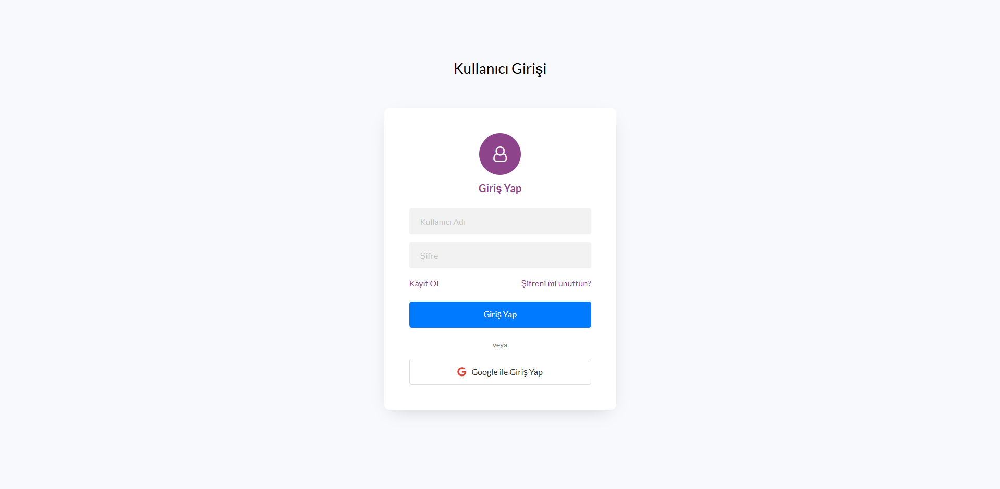
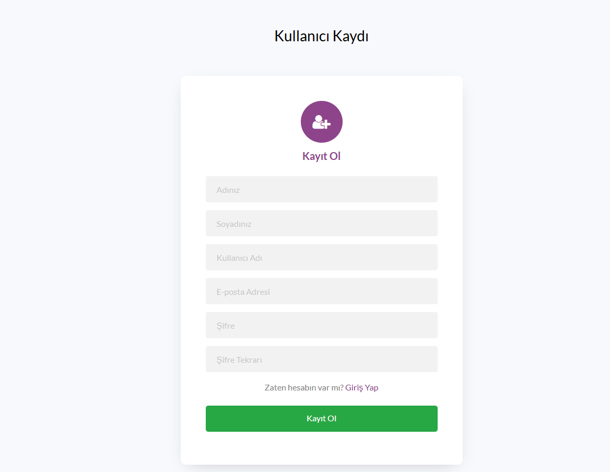
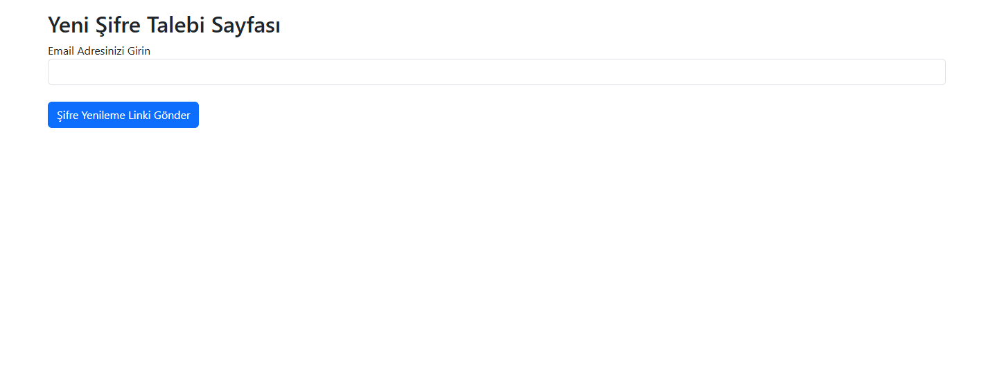
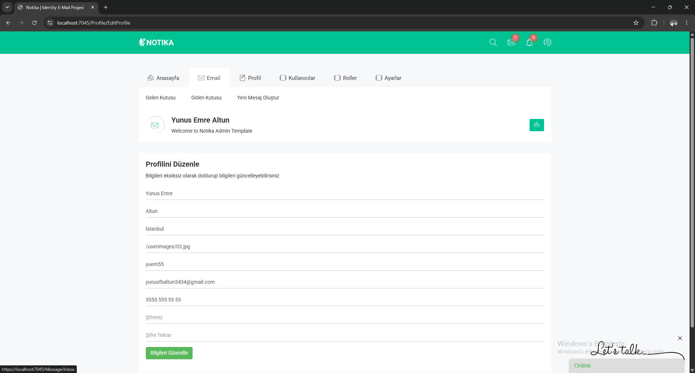
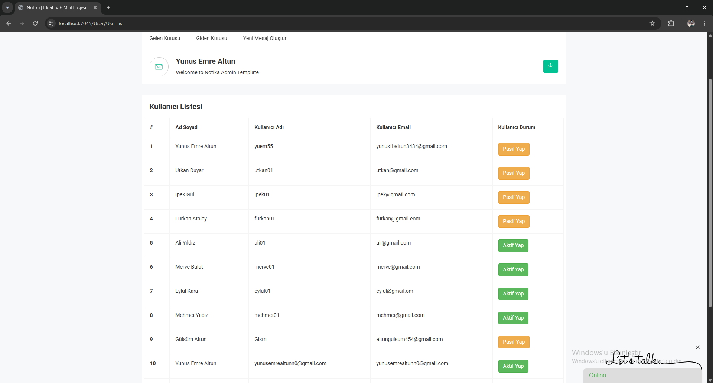
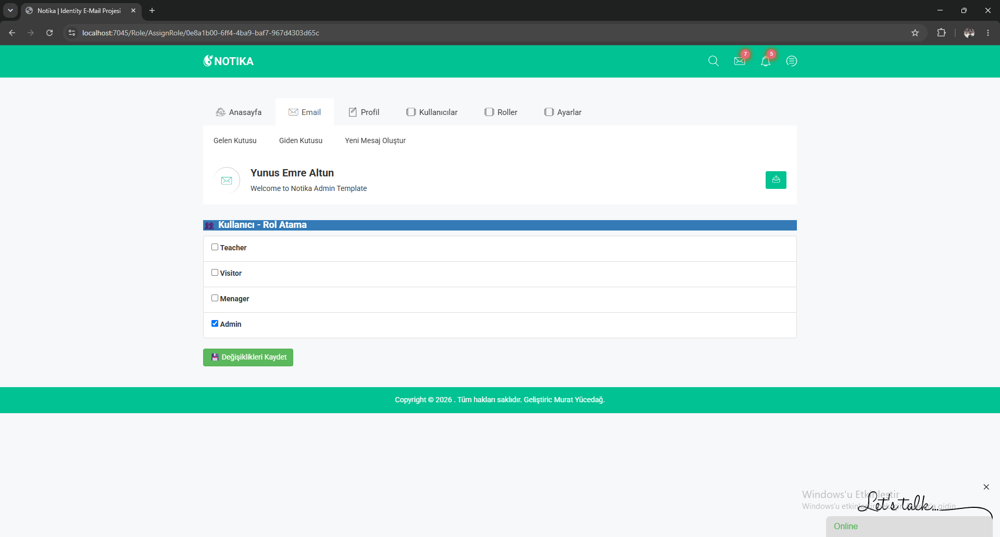
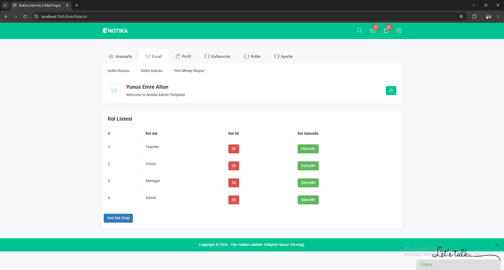
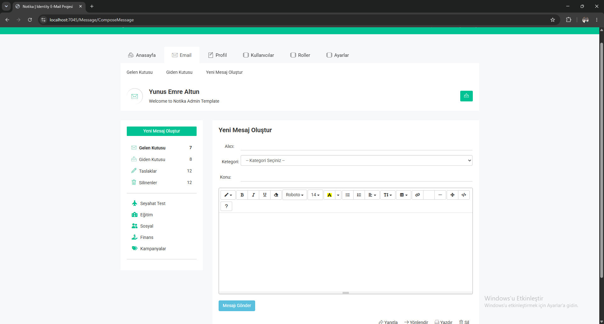
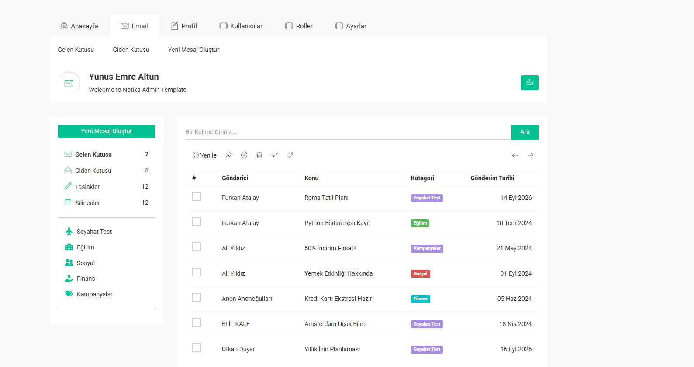
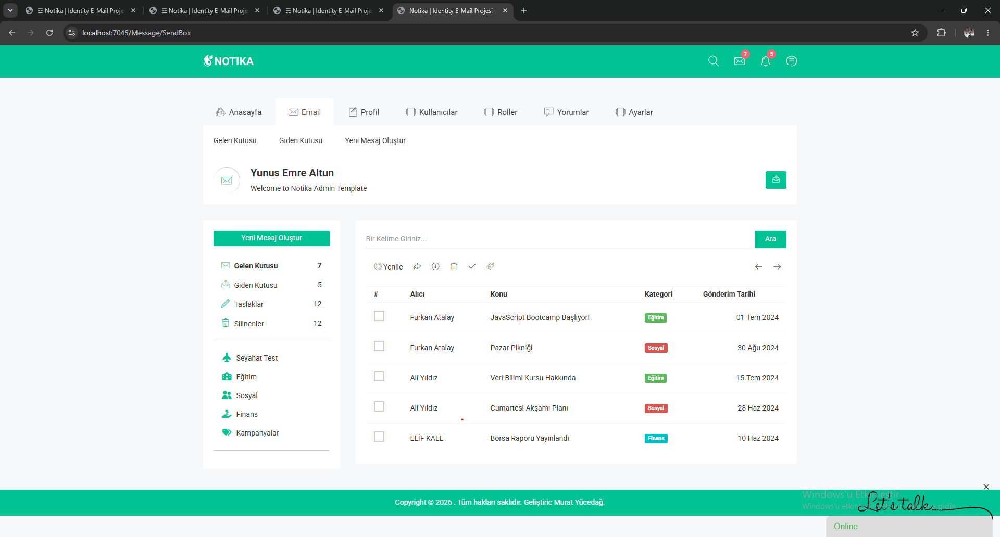

# ASP.NET Core 9.0 Identity & JWT Authentication

ASP.NET Core 9.0 ile kimlik doğrulama, yetkilendirme ve kullanıcı yönetimi konularını uygulamalı olarak ele alan MVC projesi. ASP.NET Core Identity, Cookie Authentication ve JWT'nin yanı sıra rol yönetimi, e-posta doğrulama, parola sıfırlama ve kullanıcılar arası mesajlaşma özelliklerini içerir.

## Özellikler

- Kullanıcı kaydı, girişi, çıkışı ve profil güncelleme
- ASP.NET Core Identity ile kullanıcı ve rol yönetimi
- Cookie Authentication ve JWT ile kimlik doğrulama
- Rol, Claims ve Policy tabanlı erişim kontrolü
- E-posta doğrulama ve parola sıfırlama için SMTP entegrasyonu
- JWT oluşturma, doğrulama ve korumalı kaynaklara erişim
- Özel validasyonlar ve Türkçe/İngilizce hata mesajları
- Inbox ve Outbox ile kullanıcılar arası mesajlaşma
- Summernote zengin metin editörü
- Kullanıcıya özel menüler, mesajlar ve bildirimler
- HTTP 401, 403 ve 404 hata sayfaları
- Yorumlar için Hugging Face tabanlı toksik içerik analizi

## Ekran Görüntüleri

| Giriş | Kayıt |
| --- | --- |
|  |  |

| Parola sıfırlama | Profil düzenleme |
| --- | --- |
|  |  |

| Kullanıcı listesi | Rol atama |
| --- | --- |
|  |  |

| Yeni rol | Yeni mesaj |
| --- | --- |
|  |  |

| Gelen kutusu | Giden kutusu |
| --- | --- |
|  |  |

## Teknolojiler

- C# ve ASP.NET Core 9.0 MVC
- ASP.NET Core Identity
- Entity Framework Core ve Microsoft SQL Server
- Cookie Authentication ve JWT
- SMTP
- HTML, CSS, JavaScript, Bootstrap ve Summernote

## Kurulum

### Gereksinimler

- .NET 9 SDK
- Microsoft SQL Server
- EF Core CLI (`dotnet tool install --global dotnet-ef`)

### Adımlar

1. Repoyu klonlayın ve çözümü Visual Studio ile açın:

   ```powershell
   git clone https://github.com/mryuem/NotikaIdentityEmail.git
   cd NotikaIdentityEmail
   ```

2. Proje dizininde hassas ayarları User Secrets ile tanımlayın. Gerçek değerleri kaynak koda veya GitHub'a eklemeyin:

   ```powershell
   dotnet user-secrets init --project .\NotikaIdentityEmail\NotikaIdentityEmail.csproj
   dotnet user-secrets set "JwtSettingsKey:Key" "<uzun-ve-rastgele-jwt-anahtari>" --project .\NotikaIdentityEmail\NotikaIdentityEmail.csproj
   dotnet user-secrets set "ConnectionStrings:DefaultConnection" "<sql-server-connection-string>" --project .\NotikaIdentityEmail\NotikaIdentityEmail.csproj
   ```

3. Gerekli entegrasyonlar için uygulama ortam değişkenlerini ayarlayın:

   - `GOOGLE_CLIENT_ID` ve `GOOGLE_CLIENT_SECRET`: Google ile giriş
   - `SMTP_EMAIL` ve `SMTP_APP_PASSWORD`: doğrulama ve parola sıfırlama e-postaları
   - `HUGGINGFACE_API_TOKEN`: yorum toksisite analizi

   Bu değişkenler yalnızca ilgili özellikleri kullanırken gerekir. SMTP ayarları olmadan kayıt/doğrulama ve parola sıfırlama e-postaları gönderilemez; Hugging Face token'ı olmadan toksik içerik analizi çalışmaz.

4. Veritabanı migration'larını uygulayın:

   ```powershell
   dotnet ef database update --project .\NotikaIdentityEmail\NotikaIdentityEmail.csproj
   ```

5. Uygulamayı çalıştırın:

   ```powershell
   dotnet run --project .\NotikaIdentityEmail\NotikaIdentityEmail.csproj
   ```

## Öğrenme Hedefleri

- Kimlik doğrulama ile yetkilendirme arasındaki farkı kavramak
- ASP.NET Core Identity ile kullanıcı yönetimi uygulamak
- Rol, Claims ve Policy tabanlı erişim kontrolü geliştirmek
- JWT'nin Header, Payload ve Signature yapısını incelemek
- E-posta doğrulama ve parola yenileme akışlarını oluşturmak
- ASP.NET Core uygulamalarında güvenlik mekanizmalarını uygulamalı olarak deneyimlemek

## Geliştirici

**Yunus Emre Altun**
Eğitim: Udemy — Murat Yücedağ ASP.NET Core 9.0 Identity ve JWT
